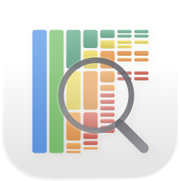
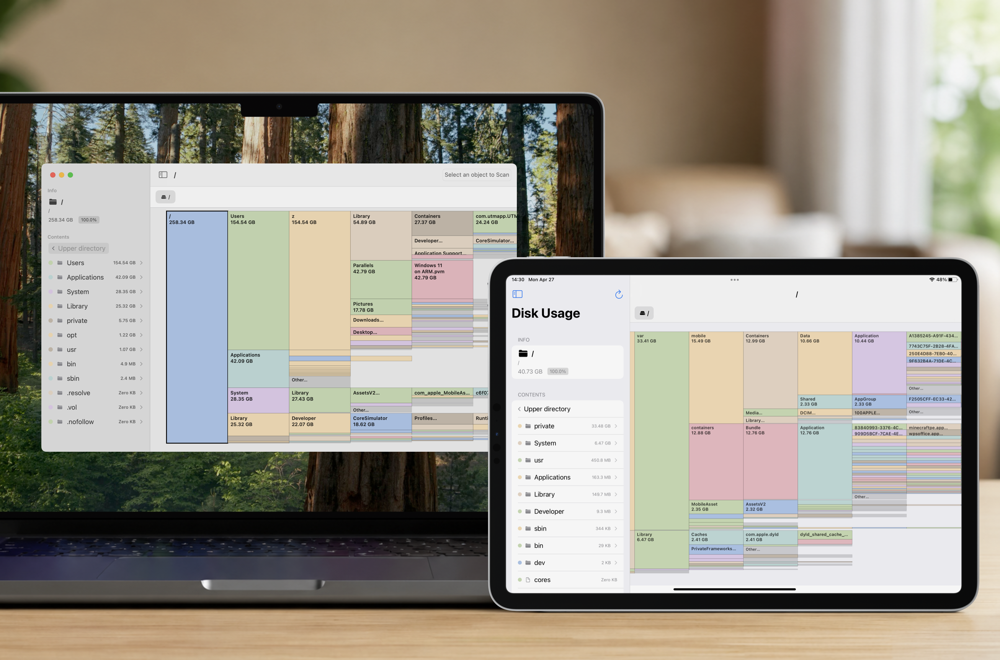

<p align="center">

</p>

<h1 align="center">Disk Icicle</h1>

<p align="center">(Maybe) the <b>first</b> disk usage visualizer for iOS. (and macOS support)</p>

---

[](https://github.com/Neighbor-Z/DiskIcicle/)[](https://github.com/Neighbor-Z/DiskIcicle/releases/latest)[](https://github.com/Neighbor-Z/DiskIcicle/releases/latest)

Disk Icicle is a disk usage visualization tool developed based on Swift. It uses an **Icicle Treemap** to intuitively display the space occupancy of folders and files, helping users quickly locate large files and bloated directories.

## Core Features

- **Intuitive & Efficient**: Uses a icicle column design where the height  directly reflects the item's volume, making it more intuitive than pie charts or plain text data. Supports color differentiation for different types of items.
- **Deep Navigation**: Click a folder to enter that level; use the top path bar to quickly navigate to any parent directory.
- **Detailed Information**: Real-time display of the selected object's name, size, percentage occupancy, and full path.
- **Quick Scanning**: Real-time scanning using native methods to obtain the actual disk space occupancy of items (macOS).
- **Multilingual Support**: Support for multiple languages.

## Picture



## Platforms

This project supports iOS/iPadOS and macOS platforms, with targeted optimizations for each platform.

### iOS/iPadOS

#### For Jailbroken/TrollStore devices

1. Download the [release](https://github.com/Neighbor-Z/DiskIcicle/releases/latest) and install with Unsandboxed permissions.
2. Use Filza or another app with a shell and untethered disk access to execute `scan_export.sh`.
3. Confirm `/var/mobile/Documents/disk_usage.txt` is successfully generated. Open Disk Icicle App and tap the `Scan` button.
4. Wait for the App to parse the `disk_usage.txt` scanning results; this process will take some time depending on the complexity of the file directory structure.

#### For other devices

Due to system sandbox restrictions, the app only supports importing from a `.txt` file scanned and generated by the `du -ak /path/to/scan/folder > disk_usage.txt 2>/dev/null` command via the iOS system file picker for visualization.

### macOS

Select any folder on the local disk for real-time scanning, or select a `.txt` text file to import results scanned and exported by the `du -ak /path/to/scan/folder > disk_usage.txt 2>/dev/null` command to generate a visual view.

### Use with Android Devices

#### Requirements

- ADB tools
- USB debugging enabled on the Android device

```bash
adb devices    # Scan for connected devices
adb shell du -ak /storage/emulated/0 > disk_usage.txt 2>/dev/null    # Start scanning from internal storage root
```

Then select this text file in Disk Icicle.

---

## License

-

## Last but not least

The design of this project was inspired by an Android app called **X-plore**. It can scan storage directories on Android devices and present the directory structure in icicle form.

One problem that has always troubled me is that the storage occupancy of iOS devices has never been transparent, making it difficult for me to clean up storage space targetedly. Since I happen to have a TrollStored iOS device, I hoped for an app that could visually present everything on the storage. However, before this project, there seemed to be no such app on the market. Therefore, I decided to build one myself so that this project was born.

---

**About AI**: AI-assisted; code snippets have been manually reviewed and tested.

**Need help?** If you encounter any issues, please open an [Issue](https://github.com/Neighbor-Z/DiskIcicle/issues).

**Contributing**: Fork this repo and make [pull requests](https://github.com/Neighbor-Z/DiskIcicle/pulls). You can also improve the translation or add your new language freely.

**Support the Project**: [☕️ Buy Me a Coffee](https://buymeacoffee.com/neighbor_z)
